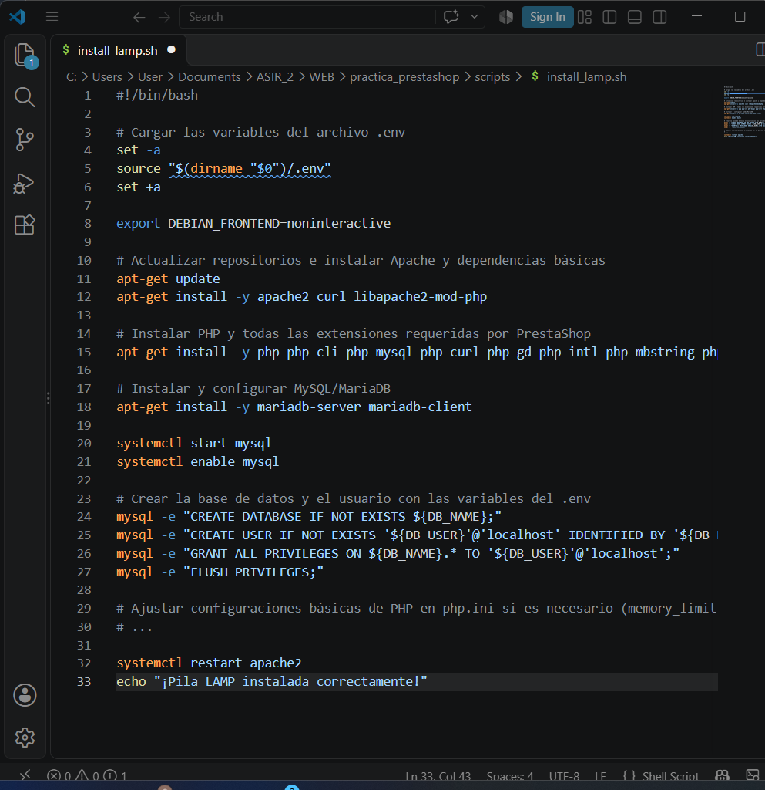
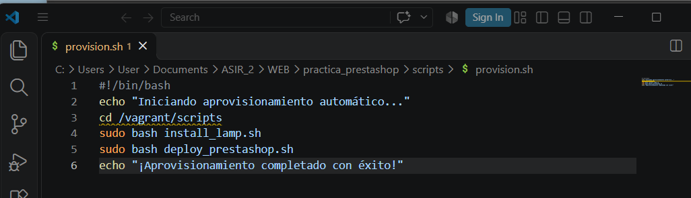
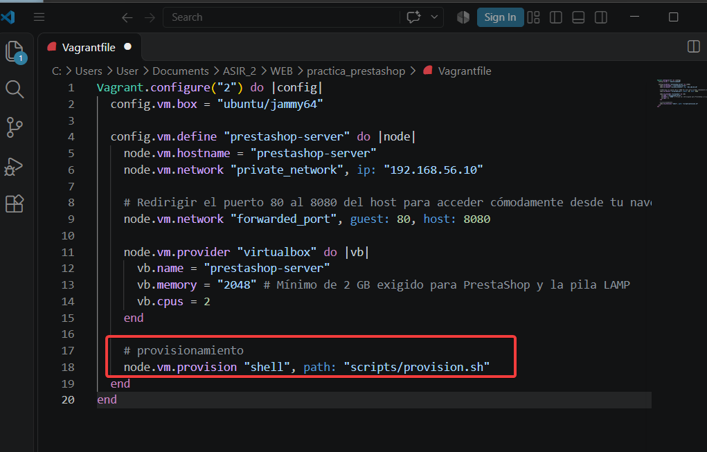

# Prácticas: Instalar Prestashop en una instancia AWS
## IWEB - ASIR 2º
### Carla González Da Costa
#### 14/11/2026

#### Descripción y Objetivos.
Esta práctica consiste en implantar la tienda online PrestaShop sobre un servidor web con la pila LAMP, adaptándola a un entorno local virtualizado en lugar de usar la nube de AWS. Su objetivo principal es aprender a automatizar todo el proceso de despliegue mediante scripts de Bash. Para ello, debes comprobar que el servidor cumple con todas las extensiones y requisitos de PHP necesarios, instalar la aplicación y entregar un repositorio en GitHub bien organizado que incluya un documento técnico en Markdown explicando los pasos y los scripts utilizados.

Para realizar el despliegue en un entorno local se ha optado por utilizar Vagrant junto con VirtualBox para automatizar la creación de una única máquina virtual que alojará de forma centralizada toda la pila LAMP (Linux, Apache, MySQL/MariaDB y PHP) y la aplicación PrestaShop.

#### 1. Directorios y Vagrantfile
Para comenzar voy a crear toda la estructura de carpetas en mi host para poder almacenar toda la información de la práctica:

- prestashop/
      - Vagrantfile
      - scripts
          - .env
          - install_lamp.sh
          - deploy_prestashop.sh
          - provision.sh

El siguiente paso es hacer un `vagrant init` desde el directorio de mi practica, para que se genere un archivo 'Vagrantfile' y luego poder modificarlo para que se creen las VMs necesarias para la práctica.

Ahora voy a modificar el archivo vagrantfile para que la vm tenga las características necesarias para esta práctica:
- Sistema Operativo: Ubuntu Server 22.04
- RAM: 2048MB
- Procesador: 2 CPUs
- Red: Red privada con IP estática (192.168.56.10) y redirección de puertos del 80 de la máquina virtual al 8080 del host para facilitar la navegación web.

Cuando hago el `vagrant up` para iniciar la máquina, siempre me sale un error de SSH, ya me pasó la práctica anterior y tengo que hacer como que voy ha apagar la máquina, para que se inicie correctamente y luego me deja conectarme bien por ssh.

Como vemos en esta imagen, ya se ha solucionado el problema. 

#### 2. Creación de scripts
El siguiente paso lógico es crear el script que configura la pila LAMP (Linux, Apache, MySQL y PHP con todas las extensiones que requiere PrestaShop).

Dentro de la carpeta scripts, creo el archivo oculto '.env' donde guardo las variables de la base de datos. 

Ahora voy a crear el scripts para automatizar la creación de la pila LAMP y lo voy a llamar 'install_lamp.sh' 

Además, creo el scripts 'deploy_prestashop.sh' para descargar e instalar automáticamente los archivos de la tienda PrestaShop en el servidor web.

Por último, creo el archivo de provisionamiento para que la máquina ya creada, pueda ejecutar todos estos scripts y modifico el vagrantfile para que esejute el provisionamiento automáticamente cuanod haga un `vagrant provision`

Adjunto la captura de la modificación del vagrantfile.

Ahora ejecuto `vagrant reload --provision`, lo prefiero a `vagrant provision` porque el primer comando lo que hace es apagar la máquina, ya que yo la tenía encendida y luego la inicia de nuevo con el provisionamiento. 

  
