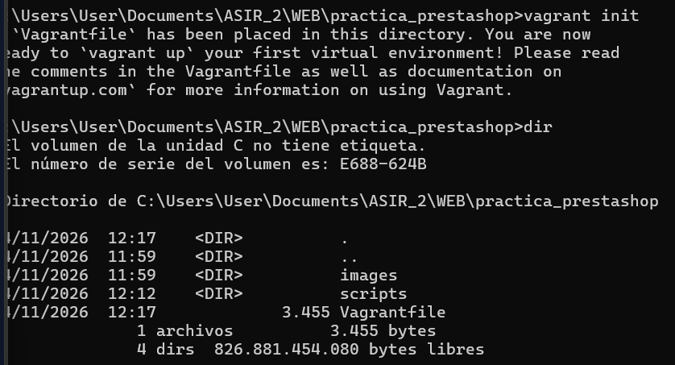
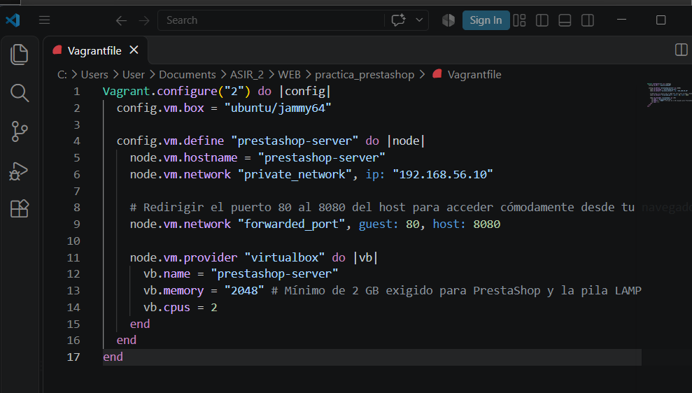
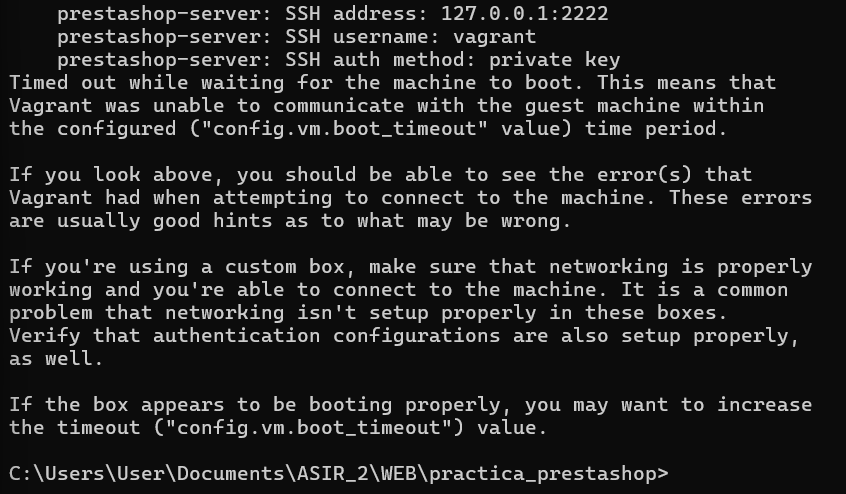
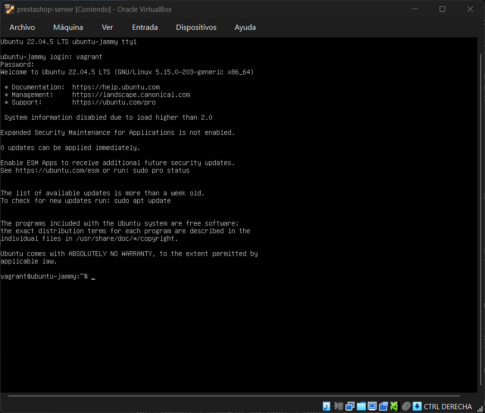
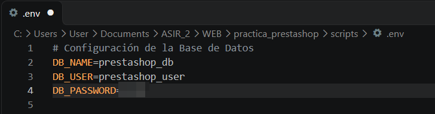
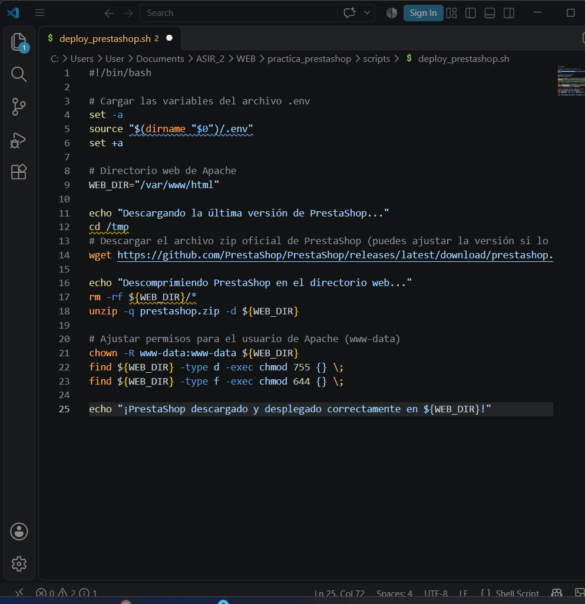
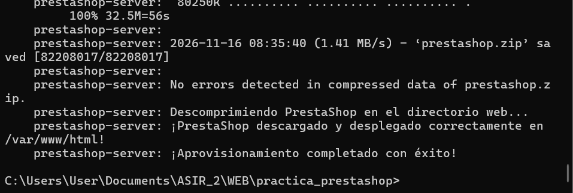
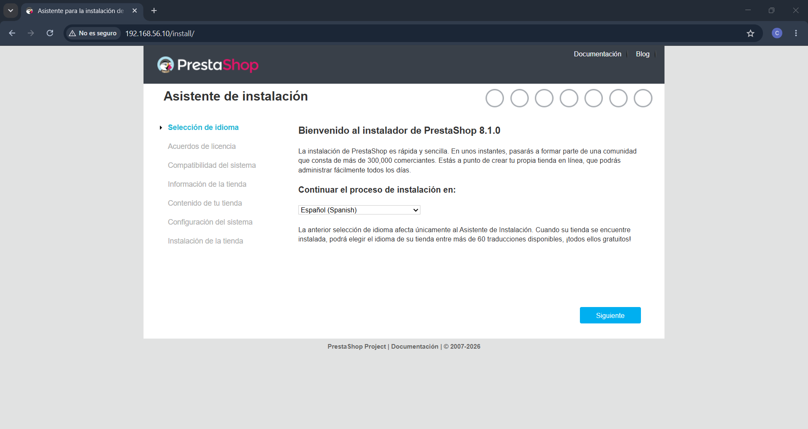
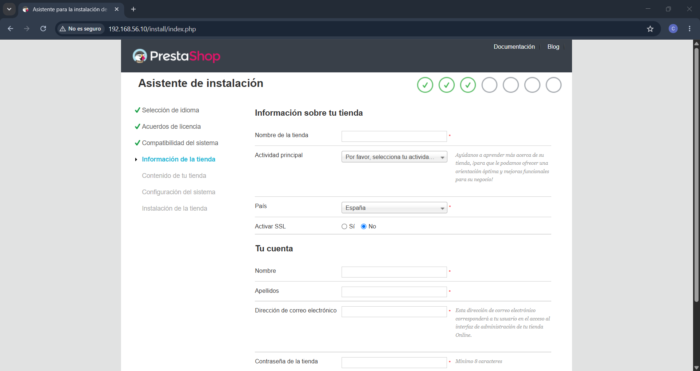

# Prácticas: Instalar Prestashop en una instancia AWS
## IWEB - ASIR 2º
### Carla González Da Costa
#### 14/11/2026

#### Descripción y Objetivos.
Esta práctica consiste en implantar la tienda online PrestaShop sobre un servidor web con la pila LAMP, adaptándola a un entorno local virtualizado en lugar de usar la nube de AWS. Su objetivo principal es aprender a automatizar todo el proceso de despliegue mediante scripts de Bash. Para ello, debes comprobar que el servidor cumple con todas las extensiones y requisitos de PHP necesarios, instalar la aplicación y entregar un repositorio en GitHub bien organizado que incluya un documento técnico en Markdown explicando los pasos y los scripts utilizados.

Para realizar el despliegue en un entorno local se ha optado por utilizar Vagrant junto con VirtualBox para automatizar la creación de una única máquina virtual que alojará de forma centralizada toda la pila LAMP (Linux, Apache, MySQL/MariaDB y PHP) y la aplicación PrestaShop.

#### 1. Directorios y Vagrantfile
Para comenzar voy a crear toda la estructura de carpetas en mi host para poder almacenar toda la información de la práctica:

- prestashop/
      - Vagrantfile
      - scripts
          - .env
          - install_lamp.sh
          - deploy_prestashop.sh
          - provision.sh

El siguiente paso es hacer un `vagrant init` desde el directorio de mi practica, para que se genere un archivo 'Vagrantfile' y luego poder modificarlo para que se creen las VMs necesarias para la práctica.



Ahora voy a modificar el archivo vagrantfile para que la vm tenga las características necesarias para esta práctica:
- Sistema Operativo: Ubuntu Server 22.04
- RAM: 2048MB
- Procesador: 2 CPUs
- Red: Red privada con IP estática (192.168.56.10) y redirección de puertos del 80 de la máquina virtual al 8080 del host para facilitar la navegación web.



Cuando hago el `vagrant up` para iniciar la máquina, siempre me sale un error de SSH, ya me pasó la práctica anterior y tengo que hacer como que voy ha apagar la máquina, para que se inicie correctamente y luego me deja conectarme bien por ssh.




Como vemos en esta imagen, ya se ha solucionado el problema. 

#### 2. Creación de scripts
El siguiente paso lógico es crear el script que configura la pila LAMP (Linux, Apache, MySQL y PHP con todas las extensiones que requiere PrestaShop).

Dentro de la carpeta scripts, creo el archivo oculto '.env' donde guardo las variables de la base de datos. 



Ahora voy a crear el scripts para automatizar la creación de la pila LAMP y lo voy a llamar 'install_lamp.sh' 


Además, creo el scripts 'deploy_prestashop.sh' para descargar e instalar automáticamente los archivos de la tienda PrestaShop en el servidor web.



Por último, creo el archivo de provisionamiento para que la máquina ya creada, pueda ejecutar todos estos scripts y modifico el vagrantfile para que esejute el provisionamiento automáticamente cuanod haga un `vagrant provision`


Adjunto la captura de la modificación del vagrantfile.


#### 3. Lanzar el provisionamiento

Ahora ejecuto `vagrant reload --provision`, lo prefiero a `vagrant provision` porque el primer comando lo que hace es apagar la máquina, ya que yo la tenía encendida y luego la inicia de nuevo con el provisionamiento. 

**Error durante el aprovisionamiento**

Al ejecutar por primera vez `vagrant reload --provision`, aparecen varios errores durante la instalación automática.

- Bloqueo del gestor de paquetes (APT): Durante la instalación de Apache y PHP aparece el siguiente error:

```bash
E: Could not get lock /var/lib/dpkg/lock-frontend.
It is held by process 1241 (unattended-upgr)
```

Esto ocurre porque Ubuntu ejecuta automáticamente un proceso de actualización (`unattended-upgrades`) y, mientras está utilizando el gestor de paquetes, no permite que nuestro script instale otros paquetes.

Para solucionarlo, modifico `install_lamp.sh` y añado una espera que comprueba si los archivos de bloqueo de APT están siendo utilizados.

```bash
while fuser /var/lib/dpkg/lock-frontend >/dev/null 2>&1 || fuser /var/lib/dpkg/lock >/dev/null 2>&1; do
    echo "Esperando a que se libere el gestor de paquetes..."
    sleep 5
done
```

El comando `fuser` permite comprobar si un proceso está utilizando un archivo. Mientras detecte que los archivos de bloqueo están ocupados, el script espera 5 segundos antes de volver a comprobarlo.

También añado `set -e` al principio del script para que, si se produce algún error durante la instalación, la ejecución se detenga y no continúe como si todo hubiera salido correctamente.

- Comprobación de los procesos de Ubuntu: como el aprovisionamiento seguía esperando, accedo a la máquina virtual mediante:

```bash
vagrant ssh
```

Una vez dentro, ejecuto:

```bash
ps -ef | grep -E 'apt|dpkg|unattended|cloud-init'
```

Este comando permite consultar los procesos relacionados con las actualizaciones y el gestor de paquetes.

También compruebo si algún proceso está utilizando el bloqueo de APT:

```bash
sudo fuser -v /var/lib/dpkg/lock-frontend
```

Compruebo que el proceso que aparecía (`unattended-upgrade-shutdown`) era un proceso auxiliar de apagado y que no estaba utilizando el archivo de bloqueo. Por tanto, modifico la condición de espera para comprobar directamente los archivos lock, en lugar de esperar a que desaparezcan todos los procesos relacionados con las actualizaciones.

- Error en la descarga de PrestaShop (404): otro de los errores iniciales se produce al descargar PrestaShop:

```bash
ERROR 404: Not Found.
```

El código HTTP 404 indica que la dirección solicitada no existe o no está disponible.

Para solucionarlo, modifico `deploy_prestashop.sh` y corrijo la dirección de descarga, utilizando el archivo ZIP correspondiente a la versión 8.1.0 de PrestaShop.

Además, añado una comprobación para verificar que el archivo descargado es un ZIP válido antes de descomprimirlo:

```bash
unzip -tq prestashop.zip
```

Este comando comprueba la integridad del archivo comprimido. Si existe algún problema, el script se detiene gracias a `set -e`.

- Modificación del aprovisionamiento: Por último, modifico `provision.sh` para añadir también `set -e`, de manera que el aprovisionamiento se detenga si falla alguno de los dos scripts.


Una vez corregidos los scripts, vuelvo a ejecutar:

```bash
vagrant reload --provision
```

En uno de los intentos aparece un error de tiempo de espera durante el arranque de la máquina. Compruebo su estado mediante:

```bash
vagrant status
```

Como la máquina aparece en estado `running`, puedo continuar el aprovisionamiento sin volver a crearla, utilizando:

```bash
vagrant provision
```

Finalmente, la descarga termina correctamente y aparecen los siguientes mensajes:



Esto confirma que PrestaShop se ha descargado, que el archivo ZIP es válido y que sus archivos se han desplegado en el directorio web de Apache.

#### 4. Comprobar desde el navegador Prestashop

Para comprobar el funcionamiento, accedo desde el navegador de Windows a:
`http://192.168.56.10`

Aparece el asistente de instalación de PrestaShop, lo instalo y compruebo que pueda crear correctamente una tienda. 






#### 5. Conclusiópn de la práctica

Con esta práctica he podido aprender sobre cómo desplegar con éxito la plataforma PrestaShop sobre un entorno virtualizado local con Vagrant, utilizando scripts automatizados para la configuración de la pila LAMP, la gestión de dependencias y la conexión con bases de datos. Así conseguimos un entorno de trabajo fiable y aislado, perfecto para desarrollar y administrar la tienda online sin complicaciones desde cualquier acceso controlado.


  
